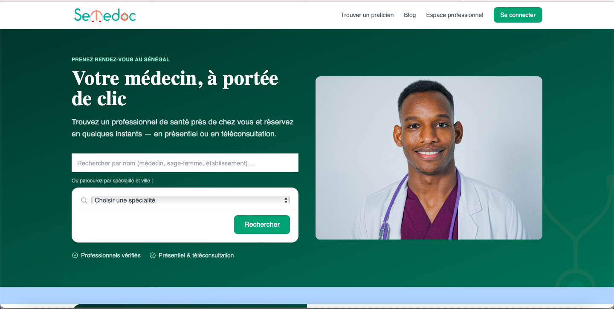
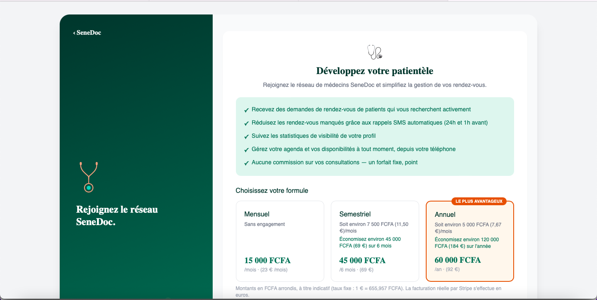
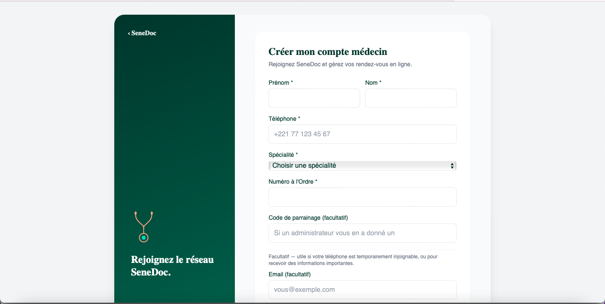

# Senedoc Frontend

Frontend of an online medical appointment platform for Senegal. Patients can find a healthcare professional, book an in-person or video consultation, and manage their appointments. Doctors manage their schedule, facilities and articles, and administrators moderate the platform.

> **Note:** This repository contains the frontend only. The REST API backend is a separate project and is not included, so the app cannot run end to end without it. No real patient or practitioner data is stored here.

## Features

**Patients**
- Search for doctors, midwives and facilities by name, specialty and city
- Practitioner profiles with availability calendar and slot booking
- Appointments for yourself or for relatives
- Favorites, profile management, support tickets
- Video consultation

**Doctors**
- Registration and profile management
- Availability and appointment management
- Facility management with a Google Maps location picker
- Subscription plans
- Blog articles with an editorial review workflow

**Administration**
- Dashboard, user and role management
- Doctor validation and rejection
- Article review and comment moderation
- Contact messages and support tickets

**Platform**
- OTP and PIN-based authentication
- reCAPTCHA-protected contact form
- Cookie consent banner and legal pages (terms, privacy, account deletion)
- Blog with SEO-friendly dynamic routes

## Tech Stack

- [Next.js](https://nextjs.org/) (App Router)
- [TypeScript](https://www.typescriptlang.org/)
- [Tailwind CSS](https://tailwindcss.com/)
- Google Maps Platform, Google reCAPTCHA
- WebSockets for real-time features

## Getting Started

```bash
git clone https://github.com/apps1global/senedoc-frontend.git
cd senedoc-frontend
npm install
cp .env.example .env.local
npm run dev
```

Open http://localhost:3000.

## Environment Variables

| Variable | Description |
|---|---|
| `NEXT_PUBLIC_API_URL` | Base URL of the backend API |
| `NEXT_PUBLIC_GOOGLE_MAPS_API_KEY` | Google Maps key (restrict it by HTTP referrer) |
| `NEXT_PUBLIC_RECAPTCHA_SITE_KEY` | reCAPTCHA v3 site key |

## Scripts

- `npm run dev`: development server
- `npm run build`: production build
- `npm start`: serve the production build

## Screenshots

### Home and search


### Doctor subscription plans


### Doctor registration


## About the Author

Built by **Honoré François Sumo**, freelance full-stack developer specializing in Next.js, TypeScript and healthcare web apps. Available for international projects.

Contracts and invoicing through **Apps 1 Global SA**, Senegal.

📧 apps1global3623@gmail.com
💬 WhatsApp: +221 78 481 98 00
